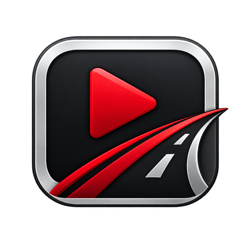

  

# Tesla Fullscreen Launcher

**Your favorite streaming platforms and social networks, together on your Tesla screen. Launch in fullscreen with a simple tap and enjoy a Tesla-style experience.**

[**Open Launcher**](https://bfmix.github.io/Tesla-fullscreen-launcher/) · [Report a Problem](https://github.com/BFMIX/Tesla-fullscreen-launcher/issues/new?template=bug_report.yml) · [Share an Idea](https://github.com/BFMIX/Tesla-fullscreen-launcher/issues/new?template=idea.yml)

Made by **BFMIX LABS**, a Tesla owner building for Tesla owners.

## Start on Your Tesla

1. While parked, open your Tesla's browser and visit **[bfmix.github.io/Tesla-fullscreen-launcher](https://bfmix.github.io/Tesla-fullscreen-launcher/)**.
2. Tap a Quick App or enter the address of a website you want to open.
3. Add the launcher to your browser favorites for your next stop.

No installation or launcher account required. An internet connection is needed.

## Your Next Charging Stop, Upgraded

| What you want | What the launcher offers |
| --- | --- |
| Open a favorite service quickly | Large Quick App cards made for touch |
| Visit something different | A field for your own website address |
| Return to a recent website | Last Opened shortcuts |
| Match your screen | Dark and Light themes, with automatic selection where supported |
| Keep your setup | Apps and preferences saved in the same browser |

Quick Apps include shortcuts to YouTube, Netflix, Disney+, Prime Video, HBO Max, Plex, Apple TV and Paramount+. You can also add links to your favorite social networks and other websites.

## Before You Launch

**Does every website work in fullscreen?**

Fullscreen behavior and playback depend on the website, vehicle software and Tesla browser. The launcher provides fullscreen launch options; it cannot guarantee that every service will open or play correctly.

**Do I need a streaming subscription?**

If a service requires a subscription or sign-in, you still need your own account. The launcher opens websites and does not provide subscriptions or media content.

**Can I use it while driving?**

Use the launcher and entertainment websites only while parked. Vehicle restrictions still apply.

**Will it remember my apps and theme?**

Your launcher preferences and saved links stay in the browser where you use them. Clearing browser data may remove them. They do not sync between vehicles or devices.

**What about privacy?**

The launcher stores its settings and saved links locally and has no built-in analytics. It loads fonts and website icons from external providers. Websites you open have their own privacy policies and sign-in requirements.

**How can I fix a connection or launch problem?**

Start with **Help & Connection Guide** inside the launcher. If the problem continues, [send a report](https://github.com/BFMIX/Tesla-fullscreen-launcher/issues/new?template=bug_report.yml) with your vehicle software version and the steps that failed. Please leave out account details and private links.

## Help the Project Grow

Enjoying the launcher? **Give the repository a Star** so you can find it again, and share the launcher link with another Tesla owner.

Real-world feedback is especially helpful: tell us what works on your Tesla, report a problem, or suggest a small improvement. You do not need to write code to contribute.

[**Support BFMIX LABS on Ko-fi**](https://ko-fi.com/bfmix) to help support the launcher's continued development. Contributions are optional; the launcher remains free to use.

[Report a problem](https://github.com/BFMIX/Tesla-fullscreen-launcher/issues/new?template=bug_report.yml) · [Suggest an improvement](https://github.com/BFMIX/Tesla-fullscreen-launcher/issues/new?template=idea.yml) · [Contribute](CONTRIBUTING.md)

---

Tesla Fullscreen Launcher is an independent community project. It is not affiliated with, sponsored by, or endorsed by Tesla, Inc. Tesla and the names of other services belong to their respective owners.

## For Developers

The launcher uses HTML, CSS and vanilla JavaScript, hosted on GitHub Pages. It has no build step or application backend. Performance on Tesla MCU2 is a priority.

Clone this repository and open `index.html` in a browser. A local static server can also be used.

Keep contributions focused on the approved product direction: a simple, touch-first launcher. Discuss feature additions and visual changes before implementation. See [CONTRIBUTING.md](CONTRIBUTING.md) for testing and pull request guidance.

The code is available under the [MIT License](LICENSE). Third-party names, trademarks and assets remain subject to their respective owners' rights.
